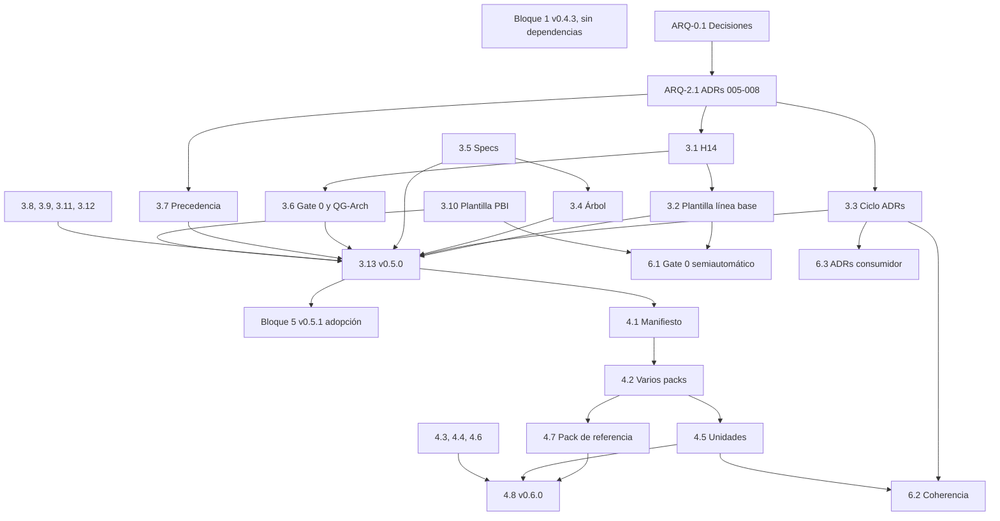

# Plan de iniciativa INIT-arquitectura — sdaf-core

| Campo | Valor |
|--------|--------|
| ID | INIT-arquitectura |
| Versión | 0.1.36 |
| Estado | Draft |
| Fecha | 2026-11-09T10:12+01:00 |
| Base | `v0.4.2` + `9c90c79` (`main`, 2026-09-27) |
| Responsable de aceptar | Manuel Ortiz de Villajos Quirós (@mortiz-iadev, CODEOWNERS) |
| ADRs | ADR-005 (Aceptado 2026-10-03), ADR-006 y ADR-007 (Aceptados 2026-10-07), ADR-008 (Aceptado 2026-10-08), ADR-009 (Aceptado 2026-10-12) |
| Worklogs | [Iteration-001](../../worklogs/INIT-arquitectura/Iteration-001.md), [Iteration-002](../../worklogs/INIT-arquitectura/Iteration-002.md), [Iteration-003](../../worklogs/INIT-arquitectura/Iteration-003.md), [Iteration-004](../../worklogs/INIT-arquitectura/Iteration-004.md), [Iteration-005](../../worklogs/INIT-arquitectura/Iteration-005.md), [Iteration-006](../../worklogs/INIT-arquitectura/Iteration-006.md), [Iteration-007](../../worklogs/INIT-arquitectura/Iteration-007.md), [Iteration-008](../../worklogs/INIT-arquitectura/Iteration-008.md), [Iteration-009](../../worklogs/INIT-arquitectura/Iteration-009.md), [Iteration-010](../../worklogs/INIT-arquitectura/Iteration-010.md), [Iteration-011](../../worklogs/INIT-arquitectura/Iteration-011.md), [Iteration-012](../../worklogs/INIT-arquitectura/Iteration-012.md), [Iteration-013](../../worklogs/INIT-arquitectura/Iteration-013.md), [Iteration-014](../../worklogs/INIT-arquitectura/Iteration-014.md), [Iteration-015](../../worklogs/INIT-arquitectura/Iteration-015.md), [Iteration-016](../../worklogs/INIT-arquitectura/Iteration-016.md), [Iteration-017](../../worklogs/INIT-arquitectura/Iteration-017.md), [Iteration-018](../../worklogs/INIT-arquitectura/Iteration-018.md), [Iteration-019](../../worklogs/INIT-arquitectura/Iteration-019.md), [Iteration-020](../../worklogs/INIT-arquitectura/Iteration-020.md), [Iteration-021](../../worklogs/INIT-arquitectura/Iteration-021.md), [Iteration-022](../../worklogs/INIT-arquitectura/Iteration-022.md), [Iteration-023](../../worklogs/INIT-arquitectura/Iteration-023.md), [Iteration-024](../../worklogs/INIT-arquitectura/Iteration-024.md), [Iteration-025](../../worklogs/INIT-arquitectura/Iteration-025.md), [Iteration-026](../../worklogs/INIT-arquitectura/Iteration-026.md), [Iteration-027](../../worklogs/INIT-arquitectura/Iteration-027.md), [Iteration-028](../../worklogs/INIT-arquitectura/Iteration-028.md), [Iteration-029](../../worklogs/INIT-arquitectura/Iteration-029.md), [Iteration-030](../../worklogs/INIT-arquitectura/Iteration-030.md), [Iteration-031](../../worklogs/INIT-arquitectura/Iteration-031.md), [Iteration-032](../../worklogs/INIT-arquitectura/Iteration-032.md), [Iteration-033](../../worklogs/INIT-arquitectura/Iteration-033.md), [Iteration-034](../../worklogs/INIT-arquitectura/Iteration-034.md), [Iteration-035](../../worklogs/INIT-arquitectura/Iteration-035.md), [Iteration-036](../../worklogs/INIT-arquitectura/Iteration-036.md) |

> [!NOTE]
> 🛠️ Plan de iniciativa: organiza trabajo sobre el core. **No** es constitución ni sustituye al [handbook](../../handbook/README.md) ni a los [ADRs](../../architecture/decisions/README.md).

**En esta página:** [Objetivo](#1-objetivo-y-alcance) · [Hallazgos](#2-hallazgos-de-partida) · [Decisiones](#3-decisiones-humanas-previas) · [Versiones](#4-estrategia-de-versiones) · [Backlog](#5-backlog-por-bloques) · [Cobertura](#6-cobertura) · [Dependencias](#7-dependencias) · [Validación](#8-validación) · [Riesgos](#9-riesgos) · [DoD](#10-definition-of-done-de-la-iniciativa) · [Siguiente paso](#11-siguiente-paso)

> [!NOTE]
> Este plan es un borrador de trabajo. Ningún PBI se ejecuta, ningún ADR se acepta y no se crea commit, rama remota, PR ni tag sin orden humana en el encargo vigente ([H06 §7](../../handbook/06-ai-agent-framework.md#7-restricciones-globales)).

---

## 1. Objetivo y alcance

**Objetivo.** Convertir la arquitectura en un artefacto gobernado del método, al mismo nivel que specs y worklogs, y cerrar el modelo de capas core → packs → overlay, sin estatizar el core a una adopción concreta.

**Dentro del alcance**

- Línea base arquitectónica del consumidor y su relación con Gate 0 y QG-Arch.
- Ciclo de vida de ADRs (sustitución, rechazo, vigencia).
- Atributos de calidad y contratos de integración en el estándar de specs.
- Trazabilidad spec/PBI → unidad arquitectónica y plantilla de PBI.
- Precedencia única entre handbook, línea base, ADRs, specs y packs.
- Modelo de capas: varios packs, manifiesto, colisiones, overlay, materialización.
- Topología con varias unidades de código.
- Adopción sobre código existente.
- Automatización semiautomática de Gate 0 y de coherencia arquitectónica.
- Coherencia de versiones en la documentación publicada.

**Fuera del alcance**

- Imponer estilo arquitectónico, notación (C4, arc42) o stack.
- Soporte de `project.language` distinto de `es` (se registra como decisión, D-8).
- Definir el rol «director técnico» (sigue abierto en H13 §8; afecta a quién aprueba, no a qué se aprueba).
- Cambios en repos consumidores más allá del piloto.

**Prueba de abstracción** (se aplica a cada PBI en review): ninguna norma nueva nombra un estilo, una notación, un stack ni un producto; todo lo concreto vive en ADRs del consumidor o en packs.

---

## 2. Hallazgos de partida

| ID | Hallazgo | Evidencia en `v0.4.2` |
|----|----------|-----------------------|
| H-1 | No existe línea base arquitectónica; G0.3 y QG-Arch no son auditables | H10 §3.2 y §4, H05 §3 G0.3, prompt `PROMPT-AGT-ARCH-001`, `templates/handbook-product.md` sin sección de arquitectura, `sdaf-bootstrap` no la crea |
| H-2 | Los ADRs registran decisiones pero no permiten calcular la arquitectura vigente | `templates/adr.md`; `check-adrs.py` fija Propuesto/Aceptado/Deprecado; sin «Sustituido por» ni Rechazado |
| H-3 | Los atributos de calidad no tienen contenido mínimo | H04 §3 cita NFRs; H04 §5 no los define |
| H-4 | Jerarquía y precedencia se contradicen; el pack no aparece | H01 §3 (Specs → ADR) frente a H01 §3.2 (ADR por encima de specs); ADR-004 sí da precedencia al tooling externo |
| H-5 | Modelo de capas incompleto | `stack.pack` escalar; contrato de pack sin rango de core, sin manifiesto ni regla de colisiones; materialización en un repo consumidor |
| H-6 | Topología de código plana | `stack.src_path` y `stack.tests_path` únicos; `check-worklog-presence.py` solo mira esas rutas |
| H-7 | Trazabilidad sin eslabón arquitectónico; backlog sin formato; Gate 0 manual | H08 §6; sin `templates/pbi.md`; tipos de spec sin contratos de integración; `validate-sdaf` solo valida config y presencia de worklog |
| H-8 | Sin camino para adoptar sobre código existente | H05 §3 y §8; ninguna mención en `docs/` |
| H-9 | Fugas de abstracción | H01 §4 «Calculation Rules»; contrato del Architecture Agent «dominio sin infra/UI»; `project.language` solo `es` sin ADR |
| H-10 | Incoherencias de versión en documentación | README (00–12, 0.3.3), H05 G2.3 («si pinnea 0.3»), H06 §3 («Por defecto en v0.2»), `sdaf.config.schema.*` y `examples/` («v0.3»), `skills/README.md` y `prompts/README.md` («Catálogo v0.3») |

---

## 3. Decisiones humanas previas

Bloquean los PBIs indicados. Recomendación en negrita; el humano decide. D-1 a D-9 están cerradas desde 2026-10-02 (la opción elegida es la recomendada); los ADR-005 a 008 están Aceptados por el humano (ARQ-2.1, hecho).

| ID | Pregunta | Opciones | Recomendación | Bloquea |
|----|----------|----------|---------------|---------|
| D-1 | ¿Gate 0 exige la línea base? | A) Sí, en línea nueva opt-in `0.5.0`. B) Solo aviso en `0.4.x`. C) Recomendada sin gate. | **Cerrada: A** (2026-10-02T18:02+02:00, Manuel Ortiz de Villajos Quirós, CODEOWNERS; transcrita del chat, aceptando la recomendación del plan). Sin gate, G0.3 y QG-Arch siguen sin ser auditables; la línea opt-in no obliga a nadie en `0.4.x` | Bloque 3 |
| D-2 | ¿Dónde vive la línea base? | A) `architecture/description.md`. B) Carpeta `architecture/description/`. C) Sección del handbook de producto. | **Cerrada: A** (2026-10-02T18:02+02:00, Manuel Ortiz de Villajos Quirós, CODEOWNERS; transcrita del chat, aceptando la recomendación del plan), con B permitido si crece (índice en el fichero) | ARQ-3.1, 3.2, 3.4 |
| D-3 | Precedencia entre ADRs y specs | A) ADR > spec (actual). B) Spec > ADR. C) Mismo nivel por materia; conflicto = STOP y enmienda. | **Cerrada: C** (2026-10-02T18:02+02:00, Manuel Ortiz de Villajos Quirós, CODEOWNERS; transcrita del chat, aceptando la recomendación del plan; ADR-007 §2) | ARQ-3.7 |
| D-4 | Número del ADR de adopción | A) Reutilizar 008 con nota. B) Reservar 008 y cambiar `check-adrs.py`. | **Cerrada: A** (2026-10-02T18:02+02:00, Manuel Ortiz de Villajos Quirós, CODEOWNERS; transcrita del chat, aceptando la recomendación del plan). La cita histórica está acotada «hasta `v0.3.3`» y el README lo aclara | ARQ-2.1 |
| D-5 | ¿Dónde se versionan los planes de iniciativa del core? | A) Fuera del repo (precedente de la auditoría v0.3.3). B) `docs/iniciativas/`. C) Carpeta nueva `initiatives/` con su checker. | **Cerrada: B** (2026-09-29T07:28+02:00, Manuel Ortiz de Villajos Quirós, CODEOWNERS; transcrita, no autodeclarada) | ARQ-0.2 |
| D-6 | Varios packs en la config | A) `stack.packs` con `stack.pack` como alias obsoleto. B) Sustituir `stack.pack` (breaking). | **Cerrada: A** (2026-10-02T18:02+02:00, Manuel Ortiz de Villajos Quirós, CODEOWNERS; transcrita del chat, aceptando la recomendación del plan) | ARQ-4.2 |
| D-7 | ¿Quién declara la compatibilidad pack ↔ core? | A) El pack en su manifiesto. B) El consumidor en la config. | **Cerrada: A** (2026-10-02T18:02+02:00, Manuel Ortiz de Villajos Quirós, CODEOWNERS; transcrita del chat, aceptando la recomendación del plan). El autor del pack es quien la conoce | ARQ-4.1 |
| D-8 | Idioma `es` fijo | A) Mantener y registrarlo como decisión explícita. B) Abrir i18n. | **Cerrada: A** (2026-10-02T18:02+02:00, Manuel Ortiz de Villajos Quirós, CODEOWNERS; transcrita del chat, aceptando la recomendación del plan). Es una decisión deliberada; solo falta registrarla | ARQ-3.12 |
| D-9 | Capítulo nuevo o enmienda | A) H14 «Descripción de arquitectura». B) Ampliar H03 y H04. | **Cerrada: A** (2026-10-02T18:02+02:00, Manuel Ortiz de Villajos Quirós, CODEOWNERS; transcrita del chat, aceptando la recomendación del plan). Añadir capítulo no renumera ni rompe citas (H13 §5) | ARQ-3.1 |

---

## 4. Estrategia de versiones

| Release | Tipo | Contenido | Breaking | Depende de |
|---------|------|-----------|----------|------------|
| `v0.4.3` | Parche, clase redacción | Coherencia de versiones (bloque 1) | No | — |
| `v0.5.0` | Línea opt-in | Arquitectura como artefacto, ciclo de ADRs, precedencia, calidad, trazabilidad, PBI, fugas de abstracción (bloque 3) | Sí (G0.6) | D-1, D-2, D-3, D-9; ADR-005, 006 y 007 §2 Aceptados |
| `v0.5.1` | Parche de línea | Adopción sobre código existente (bloque 5) | No | ADR-008 Aceptado; `v0.5.0` |
| `v0.5.2` | Parche de línea | Completa lo diferido de `v0.5.1` (H06 §6, H08 §5, `sdaf-gate0`, `sdaf-bootstrap`) | No | `v0.5.1` |
| `v0.5.3` | Parche de línea | Modo consumidor de `check-adrs.py` (ARQ-6.3) y Gate 0 semiautomático (ARQ-6.1), solo tooling y docs | No | `v0.5.2` |
| `v0.6.0` | Línea opt-in | Modelo de capas y topología (bloque 4) | Sí (contrato de pack y config) | D-6, D-7; ADR-007 Aceptado; release de `sdaf-stack-dotnet` con manifiesto |
| Transversal | En cada línea | Automatización (bloque 6) | No (opt-in en la action) | Plantillas de los bloques 3 y 4 |

Quien se quede en una línea anterior no está obligado (precedente de `0.3.0` y `0.4.0`).

Estado a 2026-11-09: `v0.4.3`, `v0.5.0`, `v0.5.1`, `v0.5.2` y `v0.5.3` publicadas; `v0.6.0` pendiente (ARQ-4.1, ARQ-4.2, ARQ-4.3, ARQ-4.4, ARQ-4.5, ARQ-4.6 y ARQ-6.2 hechos, sin publicar hasta `v0.6.0`).

**Entrega de `v0.5.0`** (decidida 2026-10-07T18:41+02:00, Manuel Ortiz de Villajos Quirós, CODEOWNERS; transcrita del chat). Estrategia `auto-chain` con cadena `feature-branch-chain` (skill `chained-pr`): rama tracker `feat/linea-0.5.0` con PR en borrador, sin fusionar hasta completar la cadena; cada slice es un PR hijo (≤400 líneas cambiadas y ≤60 min de revisión) que apunta a la rama del anterior, y el primero al tracker. Orden: S1 ciclo de vida de ADRs (ARQ-3.3); S2 H14 y plantilla de línea base (3.1, 3.2); S3 specs, árbol y PBI (3.5, 3.4, 3.10); S4a precedencia y pipeline (3.7, 3.8); S4b gates y Architecture Agent (3.6, 3.9); S5 bootstrap e idioma (3.11, 3.12); S6 release (3.13). S1 se entrega con `size:exception` aceptada: 574 líneas, más de la mitad tests, fixtures, worklog y plan. Los slices normativos no pueden aterrizar solos en `main` (H14 y G0.6 se citan entre sí), por eso la cadena no se apila sobre `main`. Cada commit local pide confirmación del humano.

---

## 5. Backlog por bloques

Formato de cada PBI: hallazgos · artefactos · clase de cambio · criterios de aceptación · dependencias.

### Bloque 0 — Decisiones y preparación

**ARQ-0.1 — Cerrar decisiones D-1 a D-9** (hecho en Iteration-005)
- Hallazgos: todos.
- Artefactos: este plan (sección 3), fila de decisión en el worklog.
- Aceptación: cada D-n con opción elegida, fecha con hora y zona, y quién decide.
- Depende de: —.

**ARQ-0.2 — Ubicar y versionar el plan** (hecho en Iteration-002)
- Artefactos: `docs/iniciativas/INIT-arquitectura.md`, `docs/iniciativas/README.md`, `docs/README.md`, `mkdocs/mkdocs.yml`.
- Aceptación: el plan está en `docs/iniciativas/`, enlazado desde el índice de HOWTO y la navegación de MkDocs; el worklog lo enlaza.
- Depende de: D-5.

### Bloque 1 — `v0.4.3`: coherencia de versiones

**ARQ-1.1 — README y handbook README** (hecho: v0.4.3)
- Hallazgos: H-10.
- Artefactos: `README.md` (tabla «Tres puertas»: 00–13 y línea 0.4.0).
- Clase: redacción.
- Aceptación: ninguna cifra de capítulos o línea contradice la tabla «Estado».

**ARQ-1.2 — Condición obsoleta en G2.3 y «v0.2» en H06 §3** (hecho: v0.4.3)
- Artefactos: `handbook/05-development-workflow.md`, `handbook/06-ai-agent-framework.md`, sus `_meta/*.yaml`.
- Clase: redacción (bump patch de capítulo, fila de historial «sin cambio de norma»).
- Aceptación: `check-version-metadata.py` y `check-history-append-only.py` en verde.

**ARQ-1.3 — Etiquetas «v0.3» en config, ejemplos y catálogos** (hecho: v0.4.3)
- Artefactos: `sdaf.config.schema.yaml`, `sdaf.config.schema.json` (description), `sdaf.config.example.yaml` (pin recomendado), `examples/README.md`, `examples/01-default-core.yaml`, `examples/08-completo.yaml`, `skills/README.md`, `prompts/README.md`.
- Clase: redacción.
- Aceptación: las etiquetas nombran la línea vigente o son neutras («línea vigente»); `validate-examples.py` en verde.

**ARQ-1.4 — Release `v0.4.3`** (hecho: tag sobre `6ea4d63`, PR #33 y #34, worklog Iteration-004)
- Artefactos: `handbook/CHANGELOG.md`, `CHANGELOG.md`, `README.md` (contenido, tabla «Estado» y fila de tag), `docs/adopcion-y-upgrade.md` (sección 0.4.3), `.github/actions/validate-sdaf/README.md` (en el PR de publicación).
- Aceptación: CHANGELOG «no rompe citas»; `sdaf.version` sigue en `"0.4.0"`; tag por orden humana.
- Depende de: ARQ-1.1 a 1.3.

### Bloque 2 — Decisiones de arquitectura

**ARQ-2.1 — Revisar y aceptar ADR-005 a 008** (hecho: ADR-005 a 008 Aceptados)
- Artefactos: `architecture/decisions/ADR-005` a `ADR-008`, índice `README.md`.
- Aceptación: cada ADR pasa a Aceptado o Rechazado por humano, con fila Aceptación; `check-adrs.py` en verde. ADR-007 puede aceptarse en dos tiempos (§2 para `0.5.0`, resto para `0.6.0`) o dividirse en dos ADRs.
- Depende de: ARQ-0.1.

### Bloque 3 — `v0.5.0`: arquitectura como artefacto

**ARQ-3.1 — Capítulo H14 «Descripción de arquitectura»** (hecho: v0.5.0, #39; H14 Approved 0.1.1)
- Hallazgos: H-1, H-3.
- Artefactos: `handbook/14-architecture-description.md`, `handbook/_meta/14-architecture-description.yaml`, `handbook/index.yaml`, `handbook/README.md`, `mkdocs/mkdocs.yml`.
- Contenido: propósito, contenido mínimo (ADR-005 §2), relación con ADRs y specs, estados, cuándo cambia, G0.6, prueba de abstracción.
- Clase: capítulo nuevo (no renumera).
- Aceptación: Draft → Approved por humano; `extract-handbook-meta.py`, `check-local-links.py --strict-anchors --strict-orphans` y `measure-handbook-scaffolding.py` en verde.
- Depende de: ARQ-2.1 (ADR-005), D-2, D-9.

**ARQ-3.2 — Plantilla de línea base** (hecho: v0.5.0, #39)
- Hallazgos: H-1.
- Artefactos: `templates/architecture-description.md`, `handbook/A-templates.md`.
- Aceptación: siete secciones de ADR-005 §2, cada una con ejemplo neutral y la opción `N/A: <motivo>`; ninguna nombra estilo, notación ni stack.
- Depende de: ARQ-3.1.

**ARQ-3.3 — Ciclo de vida de ADRs** (hecho: v0.5.0, #38)
- Hallazgos: H-2.
- Artefactos: `templates/adr.md`, `scripts/check-adrs.py`, fixtures en `scripts/testdata/`, test nuevo `scripts/test-adrs.py`, `.github/workflows/validate.yml`, `architecture/decisions/README.md` (columna de sustitución).
- Aceptación: estados de ADR-006 §1; reciprocidad de «Sustituye / Sustituido por»; «Caducidad» obligatoria en ADRs de excepción; fixtures de caso válido e inválido; ADR-001 a 008 siguen en verde.
- Depende de: ARQ-2.1 (ADR-006).

**ARQ-3.4 — Árbol del consumidor** (hecho: v0.5.0, #41)
- Hallazgos: H-1, H-7.
- Artefactos: `handbook/03-repository-organization.md` (§2 árbol y §3 tabla): `architecture/description.md` y, si se crea el tipo, `specs/integration/`.
- Clase: significado (bump minor de capítulo).
- Depende de: D-2, ARQ-3.5.

**ARQ-3.5 — Estándar de specs: calidad, integración y unidades** (hecho: v0.5.0, #41)
- Hallazgos: H-3, H-7.
- Artefactos: `handbook/04-specification-standard.md`, `templates/spec.md`.
- Cambios: §5.5 atributos de calidad con escenario medible (fuente, estímulo, entorno, respuesta, medida); tipo de spec de integración (contratos entre unidades o con terceros); campo de cabecera «Unidades»; campo «Origen» preparado para ADR-008.
- Clase: significado (bump minor).
- Aceptación: cada campo nuevo tiene ejemplo en la plantilla; H04 §8 enlaza la línea base.

**ARQ-3.6 — Gate 0 y QG-Arch contra la línea base** (hecho: v0.5.0, #43)
- Hallazgos: H-1, H-7.
- Artefactos: `handbook/05-development-workflow.md` (G0.3 redefinido, G0.6 nuevo), `handbook/10-code-review-and-quality-gates.md` (§3.2 y QG-Arch), `skills/sdaf-gate0/SKILL.md`, `skills/testing-review-pr/SKILL.md`, `prompts/review/architecture-review.md`.
- Clase: significado incompatible (motivo de la línea `0.5.0`).
- Aceptación: «toca límites» se define con la lista de ADR-005 §4; QG-Arch `N/A` solo con motivo; las skills citan la nueva versión.
- Depende de: ARQ-3.1, D-1.

**ARQ-3.7 — Jerarquía y precedencia únicas** (hecho: v0.5.0, #42)
- Hallazgos: H-4.
- Artefactos: `handbook/01-sdaf-framework.md` (§3 diagrama y §3.2), `handbook/README.md`, `AGENTS.md.template`.
- Aceptación: diagrama, flujo de H05 y lista de prioridad dicen lo mismo; aparecen línea base y packs; el conflicto spec ↔ ADR se resuelve según D-3.
- Depende de: D-3, ARQ-2.1 (ADR-007 §2).

**ARQ-3.8 — Pipeline de dominio neutral** (hecho: v0.5.0, #42)
- Hallazgos: H-9.
- Artefactos: `handbook/01-sdaf-framework.md` §4.
- Cambio: «Calculation Rules» pasa a paso opcional («reglas derivadas, si el dominio las tiene») o desaparece; se añade el eslabón de arquitectura entre casos de uso e implementación.
- Clase: significado (bump minor).

**ARQ-3.9 — Architecture Agent y skill de ADR** (hecho: v0.5.0, #43)
- Hallazgos: H-1, H-2, H-9.
- Artefactos: `agents/architecture-agent.md`, `prompts/agents/architecture-agent.md`, `prompts/system/master-architect.md`, `skills/adr-propose/SKILL.md`.
- Cambios: salidas = ADRs + línea base; checklist mantiene el índice de decisiones vigentes; se retira «dominio sin infra/UI» como norma y se sustituye por «reglas de dependencia de la línea base»; `adr-propose` aplica los estados de ADR-006.
- Aceptación: versiones y filas de historial nuevas; `check-version-metadata.py` en verde.

**ARQ-3.10 — Plantilla de PBI** (hecho: v0.5.0, #41)
- Hallazgos: H-7.
- Artefactos: `templates/pbi.md`, `handbook/05-development-workflow.md` (G0.4), `skills/spec-draft-pbi/SKILL.md`, `prompts/planning/backlog-refinement.md`.
- Campos: ID, título, specs (IDs), acceptance, unidades, ADRs, estado, worklogs.
- Aceptación: G0.4 comprobable sin interpretación.

**ARQ-3.11 — Bootstrap y handbook de producto** (hecho: v0.5.0, #44)
- Hallazgos: H-1.
- Artefactos: `skills/sdaf-bootstrap/SKILL.md` (crea línea base Draft), `templates/handbook-product.md` (enlace a la línea base), `docs/mapa-navegacion.md`.
- Aceptación: tras bootstrap en un repo vacío, Gate 0 hace STOP por specs y por línea base, y lo dice.

**ARQ-3.12 — Registrar el idioma fijo** (hecho: v0.5.0, #44; ADR-009 Aceptado)
- Hallazgos: H-9.
- Artefactos: según D-8 (nota en `sdaf.config.schema.yaml` y ADR del core si se decide registrarlo).
- Aceptación: la restricción `es` tiene una decisión citable.

**ARQ-3.13 — Release `v0.5.0`** (hecho: tag `v0.5.0` sobre `66ee77b`, #37, #45 y #47; piloto en Iteration-020)
- Artefactos: `handbook/CHANGELOG.md`, `README.md`, `docs/adopcion-y-upgrade.md` (sección 0.5.0 con migración: construir la línea base desde los ADRs vigentes), `skills/sdaf-upgrade/SKILL.md`, `sdaf.config.example.yaml`, `examples/`.
- Aceptación: todos los checks de `validate.yml` en verde; `mkdocs build --strict` en verde; piloto (sección 8) sin bloqueos; tag por orden humana.
- Depende de: ARQ-3.1 a 3.12.

### Bloque 4 — `v0.6.0`: modelo de capas y topología

**ARQ-4.1 — Manifiesto de pack** (hecho: #71 y el PR de cierre; sin publicar hasta `v0.6.0`; Iteration-029)
- Hallazgos: H-5.
- Artefactos: `docs/contrato-pack-stack.md`, `sdaf-pack.schema.json` (nuevo), `templates/sdaf-pack.yaml` (nuevo).
- Aceptación: campos `id`, `version`, `core`, `provides`, `requires`; schema con casos válido e inválido.
- Depende de: D-7, ADR-007.

**ARQ-4.2 — Varios packs en la config** (hecho: #73, #74, #75 y el PR de cierre; sin publicar hasta `v0.6.0`; Iteration-030)
- Hallazgos: H-5.
- Artefactos: `sdaf.config.schema.yaml` y `.json` (`stack.packs`, alias `stack.pack`), `scripts/validate-config.py`, `scripts/test-validate-config.py`, `scripts/testdata/`.
- Aceptación: rango `core` comprobado contra `sdaf.version`; colisión de ids entre packs = error; I4 recalculado con todos los packs; configs de `0.5.x` siguen validando con aviso de alias.
- Depende de: ARQ-4.1, D-6.

**ARQ-4.3 — Overlay y resolución por id** (hecho: #77 y el PR de cierre; sin publicar hasta `v0.6.0`; Iteration-031)
- Hallazgos: H-4, H-5.
- Artefactos: `handbook/01-sdaf-framework.md` (capas), `docs/contrato-pack-stack.md`, `AGENTS.md.template`, `sdaf.config.schema.*` (sustitución explícita de ids de extensión).
- Aceptación: reglas de ADR-007 §5 escritas en un solo sitio y citadas desde los demás.

**ARQ-4.4 — Materialización en el core** (hecho: #79 y el PR de cierre; sin publicar hasta `v0.6.0`; Iteration-032)
- Hallazgos: H-5.
- Artefactos: `docs/materializacion.md` (nuevo), `scripts/materialize.py` (nuevo, multiplataforma), test con fixture de core + dos packs + overlay; `docs/adopcion-y-upgrade.md` deja de remitir a un consumidor.
- Aceptación: materializa en Linux y Windows sin junctions; marca el origen en las copias de fallback; detecta colisiones antes de escribir.

**ARQ-4.5 — Unidades de código** (hecho: #81, #82 y el PR de cierre; sin publicar hasta `v0.6.0`; Iteration-033; `sdaf-gate0` 0.4.1 y `sdaf-bootstrap` 0.6.0 aprobadas por el humano el 2026-11-08)
- Hallazgos: H-6.
- Artefactos: `sdaf.config.schema.*` (`stack.units`), `scripts/check-worklog-presence.py`, `skills/sdaf-gate0/SKILL.md`, `skills/sdaf-bootstrap/SKILL.md`.
- Aceptación: un cambio en cualquier unidad exige worklog; `src_path`/`tests_path` siguen funcionando como una unidad; los nombres de unidad coinciden con la línea base (comprobado en ARQ-6.2).
- Depende de: ARQ-4.2.

**ARQ-4.6 — Escenarios y documentación** (hecho: el PR de cierre; sin publicar hasta `v0.6.0`; Iteration-036)
- Hallazgos: H-6.
- Artefactos: `examples/09-varios-packs.yaml`, `examples/10-varias-unidades.yaml`, `examples/README.md`, `scripts/validate-examples.py`.
- Aceptación: el 09 muestra core, dos packs y un overlay con sustitución explícita; el 10, tres unidades de código con `tests` opcional; ambos validan, el 09 también con los manifiestos de sus dos packs. `scripts/validate-examples.py` no cambia: envuelve `validate-config.py`, que valida `examples/*.yaml`, y los dos ejemplos entran solos.

**ARQ-4.7 — Coordinación con el pack de referencia**
- Artefactos externos: release de `sdaf-stack-dotnet` con `sdaf-pack.yaml`.
- Aceptación: el pack declara `core` compatible con `0.6.x`; el core actualiza la referencia en `docs/contrato-pack-stack.md`.
- Depende de: ARQ-4.2.

**ARQ-4.8 — Release `v0.6.0`**
- Aceptación: como ARQ-3.13, con piloto sobre el overlay existente.

### Bloque 5 — `v0.5.1`: adopción sobre código existente

**ARQ-5.1 — Excepción de adopción** (hecho: v0.5.1, #50)
- Hallazgos: H-8.
- Artefactos: `handbook/05-development-workflow.md` (nota junto a la excepción de spike), `handbook/13-enmienda-excepciones-ciclo-de-vida.md` §3 (tipo de excepción).
- Clase: significado sin romper gates.

**ARQ-5.2 — Specs de caracterización y ADRs de reconocimiento** (hecho: v0.5.1, #50)
- Artefactos: `handbook/04-specification-standard.md` (valor `caracterización` en «Origen»), `templates/spec.md`, `templates/adr.md` (marca «decisión heredada»).

**ARQ-5.3 — Skill `sdaf-adopt-existing`** (hecho: v0.5.1, #50)
- Artefactos: `skills/sdaf-adopt-existing/SKILL.md`, `skills/README.md`, `AGENTS.md.template`, `docs/adopcion-y-upgrade.md` (sección «Adoptar sobre un repo con código»).
- Aceptación: recorrido completo en un repo de prueba con código previo, sin violar Gate 0 en el perímetro gobernado.
- Evidencia: recorrido en repo sintético de tres unidades; el hallazgo principal (la skill predecía mal Gate 0) se corrigió en la skill 0.1.0 (Draft; aprobada como 0.1.1 el 2026-10-18, decisión M). Lo diferido (recomendación del asistente, no objetada por el humano) se reabrió por decisión del humano el 2026-10-18 («Lo hacemos ahora») y se completa en `v0.5.2`: H06 §6, `sdaf-gate0`, H08 §5 y `sdaf-bootstrap` (completado en v0.5.2, #53).

### Bloque 6 — Automatización (transversal)

**ARQ-6.1 — Gate 0 semiautomático** (hecho: #61 y #62; action y guía en el PR de cierre; publicado en `v0.5.3` junto a ARQ-6.3; Iteration-026)
- Hallazgos: H-7.
- Artefactos: `scripts/check-gate0.py`, input `check-gate0` en `.github/actions/validate-sdaf/action.yml`, fixtures.
- Comprueba: el PBI existe con la plantilla de ARQ-3.10; las specs enlazadas existen y están Approved; hay acceptance; hay worklog; línea base Approved (G0.6).
- No comprueba: si hace falta ADR (G0.3 sigue siendo juicio, ahora contra la línea base).
- Depende de: ARQ-3.10, ARQ-3.2.

**ARQ-6.2 — Coherencia arquitectónica** (hecho: #84, #85 y el PR de cierre; sin publicar hasta `v0.6.0`; Iteration-034)
- Artefactos: `scripts/check-architecture.py`, input en la action.
- Comprueba: la línea base lista todos los ADRs vigentes y ningún sustituido; las unidades de `stack.units` existen en la línea base; las specs citan unidades existentes.
- Depende de: ARQ-3.3, ARQ-4.5.

**ARQ-6.3 — ADRs del consumidor** (hecho: #58 y #59; action y guía en el PR de cierre; publicado en `v0.5.3` junto a ARQ-6.1; Iteration-025)
- Artefactos: `check-adrs.py --root` expuesto en la action (input `check-adrs`).
- Hallazgo del piloto de `0.5.0`: el checker valida hoy los ADRs del core y falla sobre los de un consumidor con formato anterior. Hace falta un **modo consumidor** que acepte fechas sin hora y zona anteriores a la línea, huecos de numeración y un índice con otras columnas (estado en otra posición).
- Depende de: ARQ-3.3.

---

## 6. Cobertura

| Hallazgo | PBIs |
|----------|------|
| H-1 | 2.1, 3.1, 3.2, 3.4, 3.6, 3.9, 3.11 |
| H-2 | 2.1, 3.3, 3.9, 6.3 |
| H-3 | 3.1, 3.5 |
| H-4 | 3.7, 4.3 |
| H-5 | 4.1, 4.2, 4.3, 4.4, 4.7 |
| H-6 | 4.5, 4.6 |
| H-7 | 3.4, 3.5, 3.6, 3.10, 6.1, 6.2 |
| H-8 | 5.1, 5.2, 5.3 |
| H-9 | 3.8, 3.9, 3.12 |
| H-10 | 1.1, 1.2, 1.3, 1.4 |

Cerrados a 2026-10-20 (al menos un PBI hecho): H-1, H-2, H-3, H-4, H-7, H-8, H-9 y H-10 (8 de 10). Abiertos: H-5 y H-6 (`v0.6.0`). A 2026-11-09 se cierra H-6 con ARQ-4.5 y ARQ-4.6 (9 de 10); queda abierto H-5 (ARQ-4.7).

---

## 7. Dependencias

Las decisiones D-n se agrupan en ARQ-0.1. El bloque 1 no depende de ninguna.

Camino crítico: ARQ-0.1 → ARQ-2.1 → ARQ-3.1 → ARQ-3.6 → ARQ-3.13.

---

## 8. Validación

| Nivel | Qué | Cuándo |
|-------|-----|--------|
| CI del core | Todos los pasos de `.github/workflows/validate.yml` y `mkdocs build --strict` | Cada PR |
| Fixtures | Casos válido e inválido para cada checker nuevo o cambiado | Cada PR que toque `scripts/` |
| Prueba de abstracción | Revisión humana: ninguna norma nueva nombra estilo, notación, stack ni producto | QG-Review de cada PR de norma |
| Piloto | Aplicar la línea en un consumidor real (el overlay existente) en rama local, sin publicar | Antes de cada tag de línea |
| Repo sintético | Repo vacío y repo con código previo para `sdaf-bootstrap` y `sdaf-adopt-existing` | ARQ-3.11, ARQ-5.3 |

El piloto es evidencia externa: sus hallazgos entran al core como cambios genéricos, nunca como referencias a ese producto.

---

## 9. Riesgos

| Riesgo | Efecto | Mitigación |
|--------|--------|------------|
| Ceremonia excesiva (contra H02 §1, simplicidad primero) | La línea base se vuelve un documento que nadie mantiene | Mínimo de una página; secciones `N/A`; solo cambia cuando cambia una unidad, regla, integración o atributo priorizado |
| Estatizar el core | Pierde generalidad | Prueba de abstracción en cada review; ejemplos neutros en plantillas |
| Fatiga de líneas breaking (`0.5.0` y `0.6.0` seguidas) | Consumidores se quedan atrás | Líneas opt-in; migración escrita; posibilidad de fusionar ambas líneas si el calendario lo permite |
| Dependencia de un repo externo (pack) | Bloquea `v0.6.0` | Manifiesto ausente = aviso durante `0.6.x`; ARQ-4.7 fuera del camino crítico de `0.5.0` |
| Un solo mantenedor | Cuello de botella en aceptaciones | Agrupar aceptaciones por bloque; ADRs pequeños |
| Colisión de numeración ADR-008 | Citas ambiguas | D-4 y nota en el índice |

---

## 10. Definition of Done de la iniciativa

- [x] D-1 a D-9 cerradas y registradas (Iteration-005).
- [x] ADR-005 a 008 Aceptados o Rechazados por humano.
- [ ] `v0.4.3`, `v0.5.0`, `v0.5.1` y `v0.6.0` publicadas o descartadas explícitamente (publicadas `v0.4.3`, `v0.5.0`, `v0.5.1`, `v0.5.2` y `v0.5.3`; falta `v0.6.0`; ARQ-6.3 y ARQ-6.1 hechos y publicados en `v0.5.3`; ARQ-4.1, ARQ-4.2, ARQ-4.3, ARQ-4.4, ARQ-4.5, ARQ-4.6 y ARQ-6.2 hechos, sin publicar hasta `v0.6.0`; 32 de 34 PBIs hechos).
- [ ] Cada hallazgo H-1 a H-10 cerrado por al menos un PBI hecho (sección 6): 9 de 10 cerrados; falta H-5.
- [ ] Piloto sin bloqueos en cada línea (hecho para `0.5.0`, sin bloqueos; en `0.5.1`, recorrido en repo sintético sin bloqueantes tras corregir la skill; pendiente en `0.6.0`).
- [ ] Worklog por iteración con cambios materiales de handbook o ADR ([H08 §5](../../handbook/08-agent-traceability.md#5-cuándo-crear-worklog)).

---

## 11. Siguiente paso

1. `v0.5.0` publicada (tag sobre `66ee77b`). La cadena de entrega queda cerrada y sus ramas, borradas.
2. `v0.5.1` publicada (tag sobre `69af58f`; #50, #51 y #52).
3. `v0.5.2` publicada (parche: lo diferido de `v0.5.1`): tag sobre `bd77795`; #53 (contenido y preparación) y #54 (chore de publicación); ramas borradas.
4. `v0.5.3` publicada (parche de solo tooling y docs: ARQ-6.3, modo consumidor de `check-adrs.py`, y ARQ-6.1, Gate 0 semiautomático; worklogs Iteration-025, 026 y 027): tag anotado sobre `75933a4`, el merge de #64 (preparación); #65 (chore de publicación); GitHub Release `sdaf-core 0.5.3` marcada Latest; ramas borradas.
5. ARQ-4.1 hecho (manifiesto `sdaf-pack.yaml` con `sdaf-pack.schema.json`, `templates/sdaf-pack.yaml` y `scripts/validate-pack.py`: #71 y el PR de cierre; Iteration-029; 26 de 34 PBIs). El validador solo comprueba el manifiesto aislado; su cruce con la config es de ARQ-4.2.
6. ARQ-4.2 hecho (`stack.packs` en la config con `stack.pack` como alias obsoleto, `--pack-manifest` con el rango `core` contra `sdaf.version`, colisiones de ids de extensión, skill y prompt, I4 con manifiestos y aviso por manifiesto ausente desde la línea 0.6.0: #73, #74, #75 y el PR de cierre; Iteration-030; 27 de 34 PBIs). Siguen sin existir el contraste de los `extension_ids` de un manifiesto con el catálogo del core y un input de la action `validate-sdaf` para pasar manifiestos.
7. ARQ-4.3 hecho (`stack.overlay.replaces` en la config con la regla de ADR-007 §5 en el validador: #77; capas y resolución por id en H01 0.4.0 §3.3, mecanismo en el contrato de pack, remisión en `AGENTS.md.template` 0.5.2, glosario 0.3.4 y desambiguación de «overlay» en `examples/` y `configuracion/`: el PR de cierre; Iteration-031; 28 de 34 PBIs). Sigue sin existir la detección de la colisión entre un pack y el overlay, que queda para la materialización (ARQ-4.4). Sin entrada de `handbook/CHANGELOG.md` hasta ARQ-4.8.
8. ARQ-4.4 hecho (`scripts/materialize.py` multiplataforma con el orden core, packs y overlay de ADR-007 §7, enlaces simbólicos relativos sin junctions, copia de fallback con marca de origen en `.sdaf-origin` y detección de colisiones antes de escribir, con `scripts/test-materialize.py` y 18 fixtures: #79; `docs/materializacion.md`, la guía de adopción sin remisión a un consumidor y el contrato de pack con la ruta normada: el PR de cierre; Iteration-032; 29 de 34 PBIs). Siguen sin existir el contraste de los `extension_ids` de un manifiesto con el catálogo del core y un input de la action `validate-sdaf` para pasar manifiestos. Seguimiento fuera de este PBI: el paso 5 de `skills/sdaf-bootstrap`, que habla de `stack.pack` y de un script de un consumidor, espera a que el humano suba la versión de la skill (Approved) y la apruebe. Sin entrada de `handbook/CHANGELOG.md` hasta ARQ-4.8. Los tres defectos menores de `scripts/materialize.py` vistos al documentarlo quedaron corregidos en un PR aparte (Iteration-035): son defectos de mensajes y no cambian lo que el script escribe ni sus códigos de salida.
9. ARQ-4.5 hecho (`stack.units` en la config con coexistencia con `src_path`/`tests_path` como error, nombre único y rutas relativas, y solape como aviso: #81; `sdaf_diff.load_units` y `load_product_prefixes` leen todas las unidades para `check-worklog-presence.py` y `check-gate0.py`, con lectura endurecida: #82; `sdaf-gate0` 0.4.1 y `sdaf-bootstrap` 0.6.0, la guía de adopción, el contrato de pack, `examples/README.md` y el README de la action: el PR de cierre; Iteration-033; 30 de 34 PBIs). Las dos skills se subieron en Draft y el humano las aprobó el 2026-11-08 con la orden expresa «Aprueba sdaf-gate0 0.4.1 y sdaf-bootstrap 0.6.0», que el agente transcribió en un segundo commit; con ello el paso 5 de `sdaf-bootstrap` (seguimiento de ARQ-4.4) queda resuelto. La comprobación de los nombres de unidad contra la línea base llegó con ARQ-6.2 (paso siguiente), y el ejemplo con varias unidades llega con ARQ-4.6, que cierra H-6. Sin entrada de `handbook/CHANGELOG.md` hasta ARQ-4.8.
10. ARQ-6.2 hecho (`scripts/check-architecture.py` con la coherencia entre la línea base, los ADRs, `stack.units` y las specs, e input opt-in `check-architecture` en la action `validate-sdaf`: la lógica compartida se movió antes a `sdaf_adrs` y `sdaf_docs` sin cambiar `check-gate0.py` en #84, el script con su test y su fixture en #85, y el input, la guía de adopción y el README de la action en el PR de cierre; Iteration-034; 31 de 34 PBIs). Es `FAIL` una unidad de `stack.units` o de una spec que no está en la línea base y un ADR sustituido o inexistente listado en su sección 6; es `AVISO` un ADR vigente que falta en esa sección y un desfase; sin línea base Approved o con `sdaf.version` anterior a `0.5.0` avisa y sale 0. No se ejecuta sobre el propio core (no tiene línea base ni specs) y no evalúa fechas de `Caducidad`. Ninguna skill, capítulo del handbook ni plantilla cambia, y sin entrada de `handbook/CHANGELOG.md` hasta ARQ-4.8.
11. ARQ-4.6 hecho (`examples/09-varios-packs.yaml` con core, dos packs ficticios y `stack.overlay.replaces` con una sustitución explícita, y `examples/10-varias-unidades.yaml` con tres unidades de código, una sin `tests`; los ejemplos 04, 05, 07 y 08 pasan del alias `stack.pack` a `stack.packs` conservando el pack y las rutas, de modo que ningún ejemplo emite ya el aviso de alias, que los fixtures `config-alias*.yaml` siguen cubriendo; `examples/README.md`, `configuracion/escenarios.md` y el contrato de pack actualizados; `scripts/test-validate-config.py` valida el 09 con los manifiestos de sus dos packs y el 10; el PR de cierre; Iteration-036; 32 de 34 PBIs). Decisiones del humano de 2026-11-09: migrar los cuatro ejemplos a `stack.packs`; `"0.5.0"` en los dos nuevos; ids ficticios `sdaf-stack-example` y `sdaf-stack-other`; el overlay dentro del 09; `scripts/validate-examples.py` no se toca (los dos ejemplos entran solos); tres unidades «Unidad A», «Unidad B» y «Unidad C», una sin `tests`. No cambian `sdaf.config.example.yaml`, los ejemplos 01, 02, 03 y 06, ninguna skill, capítulo del handbook ni plantilla. Con ARQ-4.5 y ARQ-4.6 se cierra H-6. Sin entrada de `handbook/CHANGELOG.md` hasta ARQ-4.8.
12. Siguiente trabajo: ARQ-4.7 (decisión J autorizada solo para lectura y cambio local; publicar en el repo del pack pide una autorización nueva) y ARQ-4.8.
13. `v0.6.0` (bloque 4, capas y topología): espera una release de `sdaf-stack-dotnet` con `sdaf-pack.yaml` (ARQ-4.7), que requiere autorización humana expresa sobre ese repo (decisión J, cerrada el 2026-11-06 solo para las fases de lectura y de cambio local, hasta la fusión del PR de ARQ-4.7; publicar en ese repo pide una autorización nueva).
14. Decisión K (adopción de la línea `0.5.0` en el consumidor del piloto) cerrada: la adopción se hizo entre el 2026-10-31 y el 2026-11-01; lo que sigue es backlog del consumidor, no del core. La skill `sdaf-adopt-existing` ya está aprobada (0.1.1, decisión M cerrada el 2026-10-18).
15. Adopción de la línea `0.5.0` en consumidores: decisión de cada uno, con el pin recomendado en `v0.5.3` y la línea base aprobada por un humano.

---

## Relacionado

| | Destino | Por qué |
|--|---------|---------|
| 📖 | [ADRs del core](../../architecture/decisions/README.md) | ADR-005 a 008, propuestos por esta iniciativa |
| 📖 | [H13](../../handbook/13-enmienda-excepciones-ciclo-de-vida.md) | Enmienda, breaking y bump |
| 🛠️ | [adopcion-y-upgrade.md](../adopcion-y-upgrade.md) | Dónde se documentará cada línea nueva |
| 🧭 | [Iniciativas](README.md) | Índice de planes de iniciativa |

## Historial

| Versión | Fecha | Cambio |
|---------|--------|--------|
| 0.1.36 | 2026-11-09T10:12+01:00 | ARQ-4.6 (escenarios y documentación) hecho, con lo que se cierra H-6 (junto con ARQ-4.5): `examples/09-varios-packs.yaml` (core, dos packs ficticios `sdaf-stack-example@0.1.0` y `sdaf-stack-other@0.2.0` y `stack.overlay.replaces` con una sustitución explícita) y `examples/10-varias-unidades.yaml` (`stack.units` con tres unidades, una sin `tests`), ambos con `sdaf.version` `"0.5.0"` y válidos sin avisos; los ejemplos 04, 05, 07 y 08 pasan del alias `stack.pack` a `stack.packs` conservando el pack real y las rutas, así que ningún ejemplo emite ya el aviso de alias (el alias sigue cubierto por los fixtures `config-alias*.yaml`); `examples/README.md`, `configuracion/escenarios.md` y `docs/contrato-pack-stack.md` actualizados; `scripts/test-validate-config.py` valida el 09 con los manifiestos de sus dos packs y el 10 (decisiones del humano de 2026-11-09, una a una: migrar los cuatro ejemplos, `"0.5.0"`, ids ficticios, overlay dentro del 09, no tocar `scripts/validate-examples.py` y tres unidades «Unidad A/B/C»); comprobación diferencial: las únicas diferencias de salida son el aviso de alias que desaparece de 04, 05, 07 y 08, y ningún código de salida cambia; sin cambio de `sdaf.config.example.yaml`, de los ejemplos 01, 02, 03 y 06, de skills, handbook ni plantillas, sin tag ni release ni entrada de `handbook/CHANGELOG.md` (ARQ-4.8); 32 de 34 PBIs hechos; H-6 cerrado, H-5 abierto hasta ARQ-4.7; siguiente trabajo: ARQ-4.7 (decisión J autorizada solo para lectura y cambio local; publicar en el repo del pack pide una autorización nueva) y ARQ-4.8; worklog Iteration-036 |
| 0.1.35 | 2026-11-08T20:08+01:00 | Los tres defectos menores de `scripts/materialize.py` vistos al documentar ARQ-4.4 (Iteration-032) quedan corregidos, todos de mensajes y sin cambiar lo que el script escribe ni sus códigos de salida: la colisión de un prompt con el overlay dice «en un prompt» (la de una skill, «en una skill»); un motivo idéntico del manifiesto ya no sale repetido (jsonschema emite un error `required` por propiedad ausente y cada uno nombraba todas; se deduplica en `sdaf_packs.manifest_issues`, compartido, así que `validate-pack.py` y `validate-config.py --pack-manifest` también dejan de repetirlo); y los `FAIL` de un pack de `materialize.py` muestran la ruta tal como se pasó en `--pack` (decisiones del humano de 2026-11-08, cambio local a `materialize.py`; `sdaf_packs.label_of` no cambia); tests nuevos y comprobación diferencial sin diferencias de código de salida; sin cambio de skills, handbook ni plantillas, sin tag ni release ni entrada de `handbook/CHANGELOG.md` (ARQ-4.8); 31 de 34 PBIs hechos, sin variación; siguiente trabajo sin cambios (ARQ-4.6, ARQ-4.7 y ARQ-4.8); worklog Iteration-035 |
| 0.1.34 | 2026-11-08T19:29+01:00 | ARQ-6.2 (coherencia arquitectónica) hecho: `scripts/check-architecture.py` comprueba que la línea base (sección 6 de ADRs vigentes y unidades), los ADRs, `stack.units` y las specs no se contradicen (`FAIL` por una unidad de `stack.units` o de una spec que no está en la línea base y por un ADR sustituido o inexistente listado; `AVISO` por un ADR vigente que falta en la sección 6 y por los desfases; sin línea base Approved o con `sdaf.version` anterior a `0.5.0` avisa y sale 0), con la lógica compartida movida antes a `sdaf_adrs` y `sdaf_docs` sin cambiar `check-gate0.py` (#84 fusionado, +315/−21; merge `cda0d5f`) y el script con su test y su fixture (#85 fusionado, +792 con `size:exception`; merge `3d61dc7`); input opt-in `check-architecture` (default `false`, bloqueante al activarse, tras `check-adrs`) en la action `validate-sdaf`, con README y guía de adopción (PR de cierre); no se ejecuta sobre el propio core y no evalúa fechas de `Caducidad`; sin cambio de skills, handbook ni plantillas, sin tag ni release ni entrada de `handbook/CHANGELOG.md` (ARQ-4.8); 31 de 34 PBIs hechos; H-5 y H-6 siguen abiertos hasta `v0.6.0` (H-6 hasta ARQ-4.6); siguiente trabajo: ARQ-4.6 (ejemplos 09 y 10, con varias unidades y varios packs), después ARQ-4.7 (decisión J autorizada solo para lectura y cambio local) y ARQ-4.8; worklog Iteration-034 |
| 0.1.33 | 2026-11-08T12:57+01:00 | Aprobación humana de `sdaf-gate0` 0.4.1 y `sdaf-bootstrap` 0.6.0 (ARQ-4.5), dada el 2026-11-08 con la orden expresa «Aprueba sdaf-gate0 0.4.1 y sdaf-bootstrap 0.6.0» (hora exacta de la orden no registrada; el agente transcribe, H00 §3.3): ambas pasan a Approved con una fila de historial que lo registra, `skills/README.md` 0.3.8; sin cambio de contenido de las skills ni de norma; worklog Iteration-033 ajustado |
| 0.1.32 | 2026-11-07T18:32+01:00 | ARQ-4.5 (unidades de código) hecho: `stack.units` en la config con coexistencia, nombre y rutas de ADR-007 §8 en `validate-config.py` y los schemas (#81 fusionado; merge `9fb75c6`, con el arreglo `951e3df` del ejemplo del catálogo, que sin vallas ya no rompe `docs-build`); `sdaf_diff.load_units` y `load_product_prefixes` leen todas las unidades, de modo que `check-worklog-presence.py` y `check-gate0.py` las cubren, con lectura endurecida (#82 fusionado; merge `83d8fc1`); `sdaf-gate0` 0.4.1 y `sdaf-bootstrap` 0.6.0 quedan en Draft, pendientes de aprobación humana, que se registrará en un segundo commit por orden expresa del humano; el paso 5 de `sdaf-bootstrap` queda resuelto (usa `stack.packs` y `scripts/materialize.py` desde la línea 0.6.0); `skills/README.md` 0.3.7, guía de adopción, contrato de pack, `examples/README.md` y README de la action actualizados (PR de cierre); `stack.units` se acepta con cualquier `sdaf.version`; sin tag ni release ni entrada de `handbook/CHANGELOG.md` (ARQ-4.8); 30 de 34 PBIs hechos; H-5 y H-6 siguen abiertos hasta `v0.6.0` (H-6 hasta ARQ-4.6, el ejemplo con varias unidades); siguiente trabajo: ARQ-6.2 (comprobará los nombres de unidad contra la línea base; depende de 4.5), después ARQ-4.6, ARQ-4.7 y ARQ-4.8; la decisión J (autorización sobre el repo del pack de referencia) se cerró el 2026-11-06 solo para las fases de lectura y de cambio local, hasta la fusión del PR de ARQ-4.7; worklog Iteration-033 |
| 0.1.31 | 2026-11-07T09:32+01:00 | ARQ-4.4 (materialización en el core) hecho: `scripts/materialize.py` multiplataforma con su test y 18 fixtures (#79 fusionado; merge `a8771c7`): orden core, packs y overlay (ADR-007 §7), ruta normada de los aportes (`agents/<id>-agent.md`, `prompts/agents/<id>-agent.md`, `skills/<id>/SKILL.md`), enlaces simbólicos relativos sin junctions con copia de fallback y marca de origen en el registro lateral `.sdaf-origin`, detección de la colisión entre packs y entre un pack y el overlay antes de escribir (solo en `materialize.py`; `validate-config.py` no cambia), reemplazo solo de lo propio con aborto ante conflicto y `--dry-run`; `docs/materializacion.md` nuevo, guía de adopción sin remisión a un consumidor y contrato de pack con la ruta normada (PR de cierre); H01 no cambia; el paso 5 de `skills/sdaf-bootstrap` queda como seguimiento (skill Approved: versión y aprobación del humano); sin tag ni release ni entrada de `handbook/CHANGELOG.md` (ARQ-4.8); 29 de 34 PBIs hechos; H-5 sigue abierto hasta `v0.6.0`; siguiente trabajo: ARQ-4.5 (unidades de código), de la que depende ARQ-6.2; la decisión J (autorización sobre el repo del pack de referencia) se cerró el 2026-11-06 solo para las fases de lectura y de cambio local, hasta la fusión del PR de ARQ-4.7; worklog Iteration-032 |
| 0.1.30 | 2026-11-04T23:51+01:00 | ARQ-4.3 (overlay y resolución por id) hecho: `stack.overlay.replaces` con la regla de ADR-007 §5 (id del núcleo = error, id no declarado en `agents` = error) en `validate-config.py` y los schemas (#77 fusionado); capas y resolución por id en H01 0.4.0 §3.3, mecanismo en el contrato de pack, remisión en `AGENTS.md.template` 0.5.2, glosario 0.3.4 y desambiguación de «overlay» en `examples/` y `configuracion/` (PR de cierre); para skills y prompts la colisión es siempre error y la excepción es solo para ids de extensión (agentes); `core: ">=X.Y.Z <=X.Y.Z"` como versión única aceptado por el humano (cierra el visto bueno pendiente desde ARQ-4.1); la colisión entre un pack y el overlay y la materialización quedan para ARQ-4.4; sin tag ni release ni entrada de `handbook/CHANGELOG.md` (ARQ-4.8); 28 de 34 PBIs hechos; H-5 sigue abierto hasta `v0.6.0`; siguiente trabajo: ARQ-4.4 (materialización); la decisión J sigue abierta (ya procede decidirla); worklog Iteration-031 |
| 0.1.29 | 2026-11-04T08:47+01:00 | ARQ-4.2 (varios packs en la config) hecho: `stack.packs` con `stack.pack` como alias obsoleto (aviso; coexistencia y ids repetidos = error), hueco de `provides` de ARQ-4.1 y agujero del `$` en `validate-config.py` cerrados, YAML roto sin traceback (#73 y #74 fusionados); `--pack-manifest` repetible con rango `core` contra `sdaf.version` (tupla `X.Y.Z` literal, límites `X.Y.0`), colisiones de ids de extensión, skill y prompt, I4 con manifiestos y aviso de ausencia desde la línea 0.6.0 (#75 fusionado); contrato de pack actualizado (PR de cierre); sin tag ni release; 27 de 34 PBIs hechos; H-5 sigue abierto hasta `v0.6.0`; siguiente trabajo: ARQ-4.3 (overlay); la decisión J ya procede decidirla y sigue abierta, igual que K; pendiente el visto bueno del humano sobre `>=X.Y.Z <=X.Y.Z` como versión única; worklog Iteration-030 |
| 0.1.28 | 2026-11-02T18:27+01:00 | ARQ-4.1 (manifiesto de pack) hecho: `sdaf-pack.yaml` con `sdaf-pack.schema.json`, `templates/sdaf-pack.yaml` y `scripts/validate-pack.py` con su test (#71 fusionado), y sección «Manifiesto» en el contrato de pack (PR de cierre); el validador solo comprueba el manifiesto aislado y su cruce con la config queda para ARQ-4.2; sin tag ni release; 26 de 34 PBIs hechos; H-5 sigue abierto hasta `v0.6.0`; siguiente trabajo: ARQ-4.2 (`stack.packs`); las decisiones J y K siguen abiertas; worklog Iteration-029 |
| 0.1.27 | 2026-10-25T19:29+01:00 | `v0.5.3` publicada (tag anotado sobre `75933a4`, el merge de #64; #65 como chore de publicación; GitHub Release `sdaf-core 0.5.3` marcada Latest): ARQ-6.3 y ARQ-6.1 publicados, sin PBIs nuevos (siguen 25 de 34); pin recomendado en `v0.5.3`; siguiente trabajo: camino a `v0.6.0` desde ARQ-4.1; las decisiones J y K siguen abiertas; worklog Iteration-028 |
| 0.1.26 | 2026-10-25T18:55+01:00 | Preparación del parche `v0.5.3` (ARQ-6.3 y ARQ-6.1: solo tooling y docs; capítulos, skills y `sdaf.version` sin cambios): entrada 0.5.3 en el CHANGELOG del handbook, sección 0.5.3 de la guía y textos de disponibilidad concretados; preparado, pendiente de tag; sin PBIs nuevos; worklog Iteration-027 |
| 0.1.25 | 2026-10-24T20:18+02:00 | ARQ-6.1 (Gate 0 semiautomático): `check-gate0.py` con comprobaciones mecánicas de G0.1, G0.2, G0.4, G0.5 y G0.6, bloqueante y sin aprobar nada, e input `check-gate0` en la action con guía (#61 y #62 fusionados; G0.3 y la excepción de adopción siguen siendo juicio humano); pendiente de publicar junto a ARQ-6.3; 25 de 34 PBIs hechos; worklog Iteration-026 |
| 0.1.24 | 2026-10-24T00:25+02:00 | ARQ-6.3 (modo consumidor de `check-adrs.py`): `--consumer` y `--legacy-up-to N` (corte por número), input `check-adrs` en la action y guía; pendiente de publicar junto a ARQ-6.1; worklog Iteration-025 |
| 0.1.23 | 2026-10-20T21:56+02:00 | `v0.5.2` publicada (tag sobre `bd77795`; #53 y #54): completa lo diferido de `v0.5.1` y deja `sdaf-adopt-existing` 0.1.1 aprobada; siguiente trabajo: bloque 6; worklog Iteration-024 |
| 0.1.22 | 2026-10-18T20:14+02:00 | Skill `sdaf-adopt-existing` 0.1.1 Approved por aprobación humana (decisión M cerrada, 2026-10-18); sin cambio de norma |
| 0.1.21 | 2026-10-18T19:56+02:00 | `v0.5.1` publicada (tag sobre `69af58f`; #50, #51 y #52): ARQ-5.1 a 5.3 hechos, H-8 cerrado (8 de 10); `v0.5.2` completa lo diferido (H06 0.3.5, H08 0.5.0, sdaf-gate0 0.4.0, sdaf-bootstrap 0.5.1), pendiente de revisión; worklog Iteration-023 |
| 0.1.20 | 2026-10-18T18:43+02:00 | ARQ-5.1 a 5.3 (`v0.5.1`): excepción de adopción (H05 0.6.0, H13 0.5.0), specs de caracterización y ADRs de reconocimiento (H04 0.4.0, plantillas), skill `sdaf-adopt-existing` 0.1.0 (Draft) y nota de línea opt-in en H10 0.5.1; recorrido de aceptación en repo sintético; pendiente de revisión; worklog Iteration-022 |
| 0.1.19 | 2026-10-12T20:05+02:00 | `v0.5.0` publicada (tag sobre `66ee77b`; #37, #45, #46 y #47): ARQ-3.1 a 3.13 hechos, DoD y hallazgos actualizados (7 de 10 cerrados), siguiente paso reordenado; worklog Iteration-021 |
| 0.1.18 | 2026-10-12T19:17+02:00 | Piloto de la línea `0.5.0` sobre un consumidor real, sin bloqueos: tres hallazgos genéricos (`AGENTS.md` personalizado, aviso sobre `check-adrs.py`, modo consumidor para ARQ-6.3); `sdaf-upgrade` 0.3.1 y guía de migración corregidas; worklog Iteration-020 |
| 0.1.17 | 2026-10-12T18:51+02:00 | ARQ-3.13 (slice S6): preparación de la release `v0.5.0` (CHANGELOG, README, guía de migración, `sdaf-upgrade` 0.3.0, ejemplos con `sdaf.version` "0.5.0", `linea` del índice); pendiente de revisión, del piloto y del tag por orden humana; worklog Iteration-019 |
| 0.1.16 | 2026-10-12T18:37+02:00 | ADR-009 aceptado por el humano: el idioma `es` fijo queda registrado como decisión citable (D-8); sin cambio de norma |
| 0.1.15 | 2026-10-12T18:26+02:00 | ARQ-3.11 y 3.12 (slice S5): `sdaf-bootstrap` 0.5.0 crea la línea base en Draft y el STOP cita G0.1 y G0.6; enlace a la línea base en el handbook de producto y en el mapa de navegación; idioma `es` registrado en ADR-009 (Propuesto, a la espera de la aceptación humana) con nota en el esquema; pendiente de revisión; worklog Iteration-017 |
| 0.1.14 | 2026-10-11T23:17+02:00 | ARQ-3.6 y 3.9 (slice S4b): G0.6 nuevo, G0.3 con ADR Aceptado contra la línea base, STOP en G0.1–G0.6 y QG-Arch contra la línea base (H05 y H10 0.5.0, sdaf-gate0 0.3.0, testing-review-pr 0.4.0, architecture-review 0.4.0); Architecture Agent con salidas ADRs y línea base (contrato, prompts y adr-propose 0.3.0); pendiente de revisión; worklog Iteration-016 |
| 0.1.13 | 2026-10-09T12:45+02:00 | ARQ-3.7 y 3.8 (slice S4a): precedencia única con spec y ADR al mismo nivel, línea base y packs (H01 0.3.0, handbook/README, AGENTS.md.template 0.5.0); pipeline de dominio con Calculation Rules opcional y eslabón de arquitectura; pendiente de revisión; worklog Iteration-015 |
| 0.1.12 | 2026-10-08T23:12+02:00 | ARQ-3.5, 3.4 y 3.10 (slice S3): tipo de spec de integración, campos Unidades y Origen, atributos de calidad (H04 0.3.0); árbol del consumidor (H03 0.3.0); plantilla de PBI y G0.4 comprobable (H05 0.4.0, skill y prompt de backlog); cita de H14 corregida (0.1.2); pendiente de revisión; worklog Iteration-014 |
| 0.1.11 | 2026-10-08T08:42+02:00 | ADR-008 aceptado por el humano; ARQ-2.1 hecho (ADR-005 a 008 Aceptados); el campo «Origen» de ARQ-3.5 se mantiene |
| 0.1.10 | 2026-10-08T08:32+02:00 | H14 aprobado por el humano (Draft a Approved, `0.1.1`); ARQ-3.1 y 3.2 completas en el slice S2, pendientes de fusión; worklog Iteration-012 |
| 0.1.9 | 2026-10-08T08:23+02:00 | ARQ-3.1 y 3.2 (slice S2): capítulo H14 en Draft y plantilla de línea base redactados, pendientes de revisión y de la aprobación humana de H14; worklog Iteration-011 |
| 0.1.8 | 2026-10-07T18:42+02:00 | ARQ-3.3 (slice S1, ciclo de vida de ADRs) implementada y pendiente de revisión; worklog Iteration-009 |
| 0.1.7 | 2026-10-07T18:41+02:00 | Estrategia de entrega de `v0.5.0` decidida: `auto-chain` con `feature-branch-chain`, slices S1 a S6 y `size:exception` en S1 |
| 0.1.6 | 2026-10-07T15:41+02:00 | ADR-007 aceptado por el humano (decisión completa; implementación por línea, §2 en `0.5.0`); `v0.5.0` desbloqueada; solo ADR-008 sigue Propuesto |
| 0.1.5 | 2026-10-07T15:28+02:00 | ADR-006 aceptado por el humano (ARQ-2.1 en curso); ADR-007 y 008 siguen Propuestos; ARQ-3.3 queda desbloqueado |
| 0.1.4 | 2026-10-03T11:01+02:00 | ADR-005 aceptado por el humano (ARQ-2.1 en curso); ADR-006, 007 y 008 siguen Propuestos |
| 0.1.3 | 2026-10-02T18:02+02:00 | D-1 a D-9 cerradas con la opción recomendada (ARQ-0.1); ARQ-1.1 a 1.4 hechos (`v0.4.3`); ARQ-1.4 completa sus artefactos; siguiente paso actualizado |
| 0.1.2 | 2026-09-29T07:50+02:00 | Diagrama de dependencias alineado con el texto (bloque 1 sin dependencias; 3.5, 3.8–3.12, 4.3, 4.4, 4.6 y 6.1–6.2 completos); ARQ-4.5 y 4.7 declaran su dependencia; `v0.5.1` es parche |
| 0.1.1 | 2026-09-29T07:28+02:00 | D-5 cerrada (B): el plan pasa a `docs/iniciativas/`; TOC y Relacionado |
| 0.1.0 | 2026-09-28T18:08+02:00 | Borrador inicial fuera del repo |
