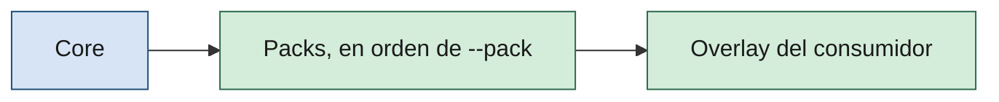

# Materialización del core

> [!NOTE]
> 🛠️ Contrato y guía de uso. No sustituye el [handbook](../handbook/README.md): la regla de resolución por id vive en [handbook/01 §3.3](../handbook/01-sdaf-framework.md#33-capas-y-resolución-por-id).
>
> **Materializar** es poner los agentes, prompts y skills del core y de los packs en las rutas del repo consumidor donde los lee el entorno de trabajo. Lo hace [`scripts/materialize.py`](../scripts/materialize.py) ([ADR-007 §7](../architecture/decisions/ADR-007-modelo-de-capas-y-precedencia.md)).

**En esta página:** [Qué es](#qué-es-y-qué-no-es) · [Orden](#orden-de-capas) · [Rutas](#convención-de-rutas) · [Uso](#uso) · [Enlaces y copias](#enlaces-simbólicos-y-copia) · [Registro](#el-registro-sdaf-origin) · [Colisiones](#colisiones) · [Re-ejecución](#re-ejecución-e-idempotencia) · [Salida](#salida-y-códigos-de-salida) · [Límites](#límites-conocidos)

## Qué es y qué no es

| Es | No es |
|----|-------|
| Un script multiplataforma (Linux y Windows) que enlaza o copia, en la raíz del consumidor, los aportes del core y de los packs. | Un validador de la config ni de los manifiestos: eso es [`validate-config.py`](../scripts/validate-config.py) y [`validate-pack.py`](../scripts/validate-pack.py). |
| Solo para **agentes**, **prompts** y **skills**. | Un materializador de `AGENTS.md` ni de las reglas de editor: los sigue materializando [`sdaf-bootstrap`](../skills/sdaf-bootstrap/SKILL.md). |
| Seguro al repetirse: reemplaza solo lo que él mismo creó. | Un gestor de versiones: el pin del core y de los packs lo decide el consumidor. |

## Orden de capas

Los aportes se aplican en este orden ([ADR-007 §7](../architecture/decisions/ADR-007-modelo-de-capas-y-precedencia.md)): primero el core, después los packs en el orden en que se pasan con `--pack`, y al final el overlay.



El script **no crea** el overlay: es lo que ya hay en el destino como fichero o directorio real, que no es un enlace simbólico ni un elemento del [registro](#el-registro-sdaf-origin). Un aporte del core o de un pack nunca pisa un fichero real del overlay: o se omite por sustitución explícita o es un error (ver [Colisiones](#colisiones)).

## Convención de rutas

Los aportes se reconocen por la ruta, que es **la misma en el core y en cada pack**, y se materializan en esa misma ruta relativa de la raíz del consumidor. El manifiesto del pack no la cambia.

| Aporte | Ruta en el core o en el pack | Se materializa como |
|--------|------------------------------|---------------------|
| Contrato de agente | `agents/<id>-agent.md` | `agents/<id>-agent.md` (fichero) |
| Prompt de agente | `prompts/agents/<id>-agent.md` | `prompts/agents/<id>-agent.md` (fichero) |
| Skill | `skills/<id>/SKILL.md` | `skills/<id>/` (directorio entero, con sus `references/`) |

Lo que no encaja en esa tabla se ignora: un `README.md` dentro de `agents/` o `skills/`, o un directorio de `skills/` sin `SKILL.md`. El `<id>` de un agente y de su prompt es el nombre del fichero sin el sufijo `-agent.md`.

## Uso

```text
python .sdaf/scripts/materialize.py [--consumer-root RAIZ] [--core RUTA] [--pack RUTA]...
                                    [--mode auto|symlink|copy] [--dry-run]
```

| Argumento | Defecto | Significado |
|-----------|---------|-------------|
| `--consumer-root` | Directorio actual | Raíz del repo consumidor, donde se escribe. |
| `--core` | `<consumer-root>/.sdaf` | Raíz del core (el submódulo pinneado de la [guía de adopción](adopcion-y-upgrade.md)). |
| `--pack RUTA` | Ninguno | Raíz de un pack con su `sdaf-pack.yaml`. Repetible; el orden de los argumentos es el orden de las capas. Un manifiesto ausente o inválido es un `FAIL`. |
| `--mode` | `auto` | `symlink`, `copy` o `auto`: ver [Enlaces simbólicos y copia](#enlaces-simbólicos-y-copia). |
| `--dry-run` | Apagado | Imprime el plan y no escribe nada, tampoco el registro. |

Requiere PyYAML y jsonschema, como el resto de scripts que leen manifiestos. Del `sdaf.config.yaml` del consumidor solo lee la lista opcional `stack.overlay.replaces` (ver [Colisiones](#colisiones)).

Ejemplo con dos packs ficticios, `example` y `otro`, desde la raíz del consumidor:

```bash
python .sdaf/scripts/materialize.py --pack packs/example --pack packs/otro --dry-run
python .sdaf/scripts/materialize.py --pack packs/example --pack packs/otro
```

La primera línea solo planifica; la segunda escribe. Salida de la segunda en un sistema con enlaces simbólicos:

```text
OK  agents/architecture-agent.md <- core [symlink]
OK  agents/example-extension-agent.md <- pack:sdaf-stack-example [symlink]
OK  agents/other-extension-agent.md <- pack:sdaf-stack-other [symlink]
OK  agents/specification-agent.md <- core [symlink]
OK  prompts/agents/example-extension-agent.md <- pack:sdaf-stack-example [symlink]
OK  prompts/agents/other-extension-agent.md <- pack:sdaf-stack-other [symlink]
OK  prompts/agents/specification-agent.md <- core [symlink]
OK  skills/core-skill <- core [symlink]
OK  skills/example-skill <- pack:sdaf-stack-example [symlink]
OK  skills/other-skill <- pack:sdaf-stack-other [symlink]
OK  10 elementos materializados desde 3 capas (.sdaf-origin)
```

La capa se escribe `core` o `pack:<id>`, con el `id` del manifiesto del pack (`sdaf-stack-<id>`), no con el nombre de su directorio.

## Enlaces simbólicos y copia

| Modo | Qué hace |
|------|----------|
| `symlink` | Crea enlaces simbólicos **relativos**. Si el sistema no permite crearlos, falla (`FAIL --mode symlink: el sistema no permite crear enlaces simbólicos; use --mode copy o auto`). |
| `copy` | Copia siempre. |
| `auto` | Intenta el enlace y, si el sistema no lo permite, copia y lo avisa: `INFO el sistema no permite enlaces simbólicos: se copia`. |

Un enlace relativo se resuelve desde el directorio donde está, de modo que sobrevive a mover el repo. Ejemplo real de lo que deja el script en `agents/`:

```text
architecture-agent.md -> ../.sdaf/agents/architecture-agent.md
example-extension-agent.md -> ../packs/example/agents/example-extension-agent.md
```

> [!WARNING]
> **Nunca se crean junctions de Windows** (`mklink /J`): son rutas absolutas que no sobreviven a mover el repo ni a otro clon. Si el sistema no permite enlaces simbólicos, la alternativa es la copia, que lleva su [marca de origen](#el-registro-sdaf-origin).

La copia es el fallback, no la norma: duplica el contenido y se queda atrás si el origen cambia hasta que se vuelve a ejecutar el script. Una copia **no se altera**: ni su contenido ni el frontmatter de una skill llevan marca; el origen vive en el registro.

## El registro `.sdaf-origin`

Es un fichero lateral en la raíz del consumidor (JSON ordenado, UTF-8, LF, `version: 1`) con una entrada por cada elemento que el script materializó, enlace o copia:

| Campo | Contenido |
|-------|-----------|
| `dest` | Ruta del destino relativa a la raíz, con `/` (p. ej. `skills/example-skill`). |
| `layer` | `core` o `pack:<id>`. |
| `origin` | Ruta del origen relativa a la raíz del consumidor (absoluta solo si no existe ruta relativa). |
| `type` | `symlink` o `copy`. |
| `sha256` | Hash del contenido del origen. Para una skill, un hash determinista de todos sus ficheros. |

Sirve para cuatro cosas: **dejar constancia del origen** de cada copia sin tocar su contenido; **distinguir lo propio de lo ajeno** (un fichero real que no figura aquí es del overlay); **detectar una copia o un enlace editados** antes de reemplazarlos; y **retirar** lo que el core o un pack ya no aportan. El script rechaza un registro mal formado, con destinos fuera de la [convención](#convención-de-rutas) o repetidos.

> [!TIP]
> Versione `.sdaf-origin` junto con los enlaces o copias. Sin él, otro clon vería esos elementos como ajenos al script: un enlace sin registro es un `FAIL`, y una copia sin registro, un conflicto con el overlay.

## Colisiones

La **norma** (qué es una colisión, qué ids se sustituyen y cuál es la única excepción) está en [handbook/01 §3.3](../handbook/01-sdaf-framework.md#33-capas-y-resolución-por-id) y no se repite aquí. Esta sección describe el mecanismo: el script las detecta **antes de escribir nada** y, con una sola, aborta con `FAIL no se escribió nada`. Es el único sitio donde se detecta la colisión entre un pack y el overlay; `validate-config.py` no la comprueba.

| Situación | Resultado | Mensaje (ids ficticios) |
|-----------|-----------|--------------------------|
| El core y un pack, o dos packs, aportan el mismo destino | `FAIL` | `agents/example-extension-agent.md: colisión, lo aportan pack:sdaf-stack-example y pack:sdaf-stack-other` |
| El overlay ocupa un destino del núcleo | `FAIL` | `agents/architecture-agent.md: el overlay ocupa un destino del núcleo; los ids del núcleo no se sustituyen` |
| El overlay ocupa el contrato de agente de un pack y su id **no** está en `stack.overlay.replaces` | `FAIL` | `agents/example-extension-agent.md: colisión entre el pack sdaf-stack-example y el overlay; declare 'example-extension' en stack.overlay.replaces para sustituirlo` |
| El overlay ocupa el contrato de agente de un pack y su id **sí** está en `stack.overlay.replaces` | `INFO`, se respeta el overlay | `agents/example-extension-agent.md: se respeta el del overlay (stack.overlay.replaces), se omite el de pack:sdaf-stack-example` |
| El overlay ocupa una skill o un prompt de un pack | `FAIL`, sin excepción | `skills/example-skill: colisión entre el pack sdaf-stack-example y el overlay en una skill; las skills y los prompts no se sustituyen` |

La sustitución se declara en la config del consumidor, con la lista que ya valida [`validate-config.py`](../scripts/validate-config.py) (ver [Resolución por id](contrato-pack-stack.md#resolución-por-id)):

```yaml
stack:
  overlay:
    replaces:
      - example-extension
```

Alcance de la sustitución: solo el **contrato de agente**. El prompt del pack con ese mismo id se sigue materializando; si el overlay tiene un fichero propio en esa ruta de prompt, es una colisión.

Si el mismo `id` de pack se pasa dos veces con `--pack`, también es un `FAIL`.

## Re-ejecución e idempotencia

El script puede ejecutarse tantas veces como haga falta. Solo reemplaza lo que figura en el registro **y** sigue siendo, en el destino, el enlace o la copia que el registro describe:

| Caso | Resultado |
|------|-----------|
| Nada cambió | `OK  <destino> sin cambios (<capa>)`. El árbol y el registro quedan idénticos. |
| Cambió el origen, la capa o el contenido del origen | El elemento se reemplaza y el registro se actualiza. |
| Una copia o un enlace registrados fueron editados o redirigidos | `FAIL <destino>: el elemento registrado (copy) fue modificado; revíselo o elimínelo antes de volver a materializar`, sin escribir nada. |
| Un enlace simbólico en el destino no figura en el registro | `FAIL <destino>: el destino es un enlace simbólico que no figura en .sdaf-origin`. |
| El destino choca con un fichero real del overlay | Ver [Colisiones](#colisiones). |
| Un elemento registrado ya no se aporta (se quitó el pack) | Si sigue intacto, se elimina: `OK  <destino> eliminado (ya no se aporta, <capa>)`. |
| Un elemento registrado ya no se aporta y fue modificado | Se **conserva**, con `WARN <destino>: ya no se aporta y fue modificado; se conserva y deja de figurar en .sdaf-origin`. |

Un directorio padre que sea un enlace simbólico, o un destino cuyo padre no sea un directorio, es un `FAIL` en el plan. Si el sistema de ficheros falla a mitad de la escritura, el script informa `FAIL error del sistema de ficheros: ...` y deja en el registro lo ya escrito; volver a ejecutarlo continúa.

### Vista previa con `--dry-run`

`--dry-run` calcula el mismo plan, avisa de los mismos conflictos y no escribe nada, tampoco `.sdaf-origin`. Extracto de la salida:

```text
INFO plan: crear agents/architecture-agent.md <- core [symlink]
INFO plan: crear skills/example-skill <- pack:sdaf-stack-example [symlink]
OK  dry-run: 10 acciones planificadas, no se escribió nada
```

## Salida y códigos de salida

Cada línea empieza por `OK`, `INFO`, `WARN` o `FAIL <motivo>`. `WARN` e `INFO` no cambian el resultado.

| Código | Cuándo |
|--------|--------|
| `0` | Todo correcto, también con `WARN` o `INFO`, y con `--dry-run`. |
| `1` | Hay algún `FAIL`: un core o un pack inexistente, un manifiesto inválido, una colisión, un conflicto de re-ejecución o un error del sistema de ficheros. Si el `FAIL` es del plan, no se escribe nada. |
| `2` | Argumentos de la línea de órdenes mal formados (lo emite el analizador de argumentos). |

## Límites conocidos

- **No valida `provides`.** Se materializa lo que hay en disco según la [convención](#convención-de-rutas); el script no cruza los ficheros con los `provides` del manifiesto ni con los `extension_ids` ([qué no existe todavía](contrato-pack-stack.md#qué-no-existe-todavía)).
- **No valida la config.** Solo lee `stack.overlay.replaces`; el resto de reglas siguen en `validate-config.py`.
- **Enlaces reales en Windows.** Los enlaces simbólicos reales se han ejercitado en Linux. En Windows, si el sistema no permite crearlos, `auto` copia.
- **Solo tres tipos de aporte.** `AGENTS.md`, las reglas de editor y cualquier otro fichero del core o del pack quedan fuera.

## Relacionado

| | Destino | Por qué |
|--|---------|---------|
| 📖 | [handbook/01 §3.3](../handbook/01-sdaf-framework.md#33-capas-y-resolución-por-id) | Norma de capas y resolución por id |
| 📖 | [ADR-007](../architecture/decisions/ADR-007-modelo-de-capas-y-precedencia.md) | Decisión del modelo de capas (§5 resolución, §7 materialización) |
| 📦 | [contrato-pack-stack.md](contrato-pack-stack.md) | Manifiesto, ruta normada de los packs y validación |
| 🛠️ | [adopcion-y-upgrade.md](adopcion-y-upgrade.md) | Submódulo del core y bootstrap |
| 🛠️ | [skills/sdaf-bootstrap](../skills/sdaf-bootstrap/SKILL.md) | Materializa `AGENTS.md` y las reglas de editor |
